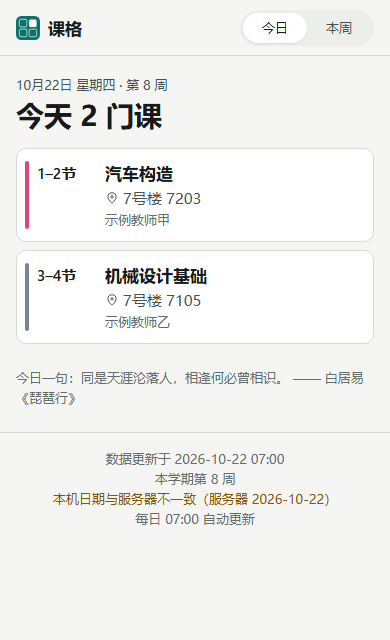
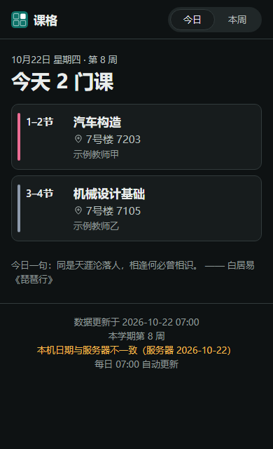
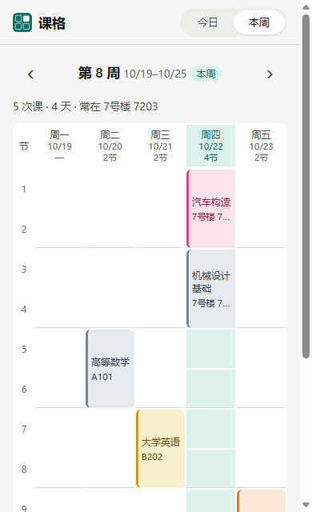
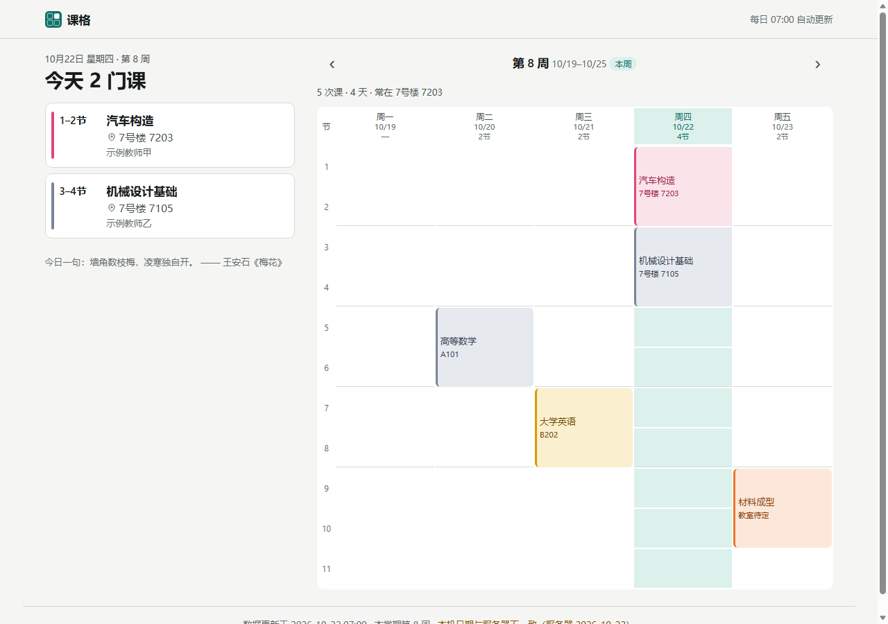

# 课格

课格是面向陕西理工大学的课表自动推送与只读课表网站，以松石绿为主色，一次抓取生成邮件内容和网站使用的脱敏 JSON 快照。

## 效果截图

截图均使用合成数据，不含真实个人信息。

| 手机今日 · 浅色 | 手机今日 · 深色 | 手机周课表 |
|---|---|---|
|  |  |  |



界面规格见 [设计文档](docs/DESIGN.md)，实际实现以 `web/` 为准。

## 特性

- 一次抓取，生成邮件与脱敏快照；可选 Server酱微信推送。
- 会话按 Cookie 复用、静默 SSO、完整登录的顺序恢复，减少重复认证；支持可选验证码 OCR 和人工兜底。
- HTTP 适配器限速与重试，适配响应慢、有防刷限制的学校系统。
- 网站只读快照，访问和翻周不触发教务请求；支持共享访问口令与失败限速。
- 纯 HTML、CSS、JavaScript，无前端构建步骤、外链脚本或远程字体。
- 手机今日与周视图、桌面双栏、跟随系统深色模式、课程详情、键盘操作与打印样式。
- 快照原子写入；抓取失败保留旧快照，网页显示更新时间，正常推送模式会尝试发送失败告警。

## 架构

```text
定时任务 / CLI
  └─ 金智 CAS 登录 → 树维 EAMS 抓取 → CourseTable
                                      ├─ formatter → 邮件（可选 Server酱）
                                      └─ snapshot → data/timetable.json
                                                        │ 只读
                                                 FastAPI 网站
                                                        │
                                                  浏览器本地渲染
```

`snut/webapp.py` 不得 import `auth` / `course` / `captcha`，网站访问不得触发学校请求。
快照通过字段白名单排除学号、内部学生 ID 与课程编码；仍包含课程、教师和教室信息，不能理解为完全匿名数据。
当前 Web 共用 `Config`，会加载学校账号配置，因此不能宣称网站进程不持有凭证。详见 [架构说明](docs/ARCHITECTURE.md)。

## 快速开始

代码兼容 Python 3.8 语法；依赖安装以所用 Python 版本与依赖包支持范围为准。前端自测另需 Node.js，CI 使用 Node.js 20。

```bash
git clone https://github.com/genhaoer66/snut-course-notifier.git
cd snut-course-notifier
python -m venv .venv
```

激活虚拟环境：Windows PowerShell 执行 `.venv\Scripts\Activate.ps1`；Linux / macOS 执行 `source .venv/bin/activate`。

```bash
python -m pip install -r requirements.txt
# 可选：验证码 OCR
python -m pip install -r requirements-optional.txt
```

复制 [配置模板](.env.example) 为 `.env`（PowerShell：`Copy-Item .env.example .env`；Linux / macOS：`cp .env.example .env`）。
填写自己的 `SNUT_USERNAME`、`SNUT_PASSWORD`，并按学校校历填写 `SEMESTER_START`。模板日期不是每学期都适用。
需要邮件时再填写 `SMTP_USER`、`SMTP_AUTH_CODE`、`MAIL_TO`；其中授权码不是邮箱登录密码。

```bash
python -m snut.main --dry-run
python -m uvicorn snut.webapp:app --host 127.0.0.1 --port 8000
```

打开 <http://127.0.0.1:8000>。`--dry-run` 仍会登录学校、抓取课表、保存会话与更新快照，只是不发推送；它不是离线模式。
首次未生成快照时，网站提示暂无数据。需要助手引导配置时可参阅 [AGENT_SETUP.md](AGENT_SETUP.md)。

## 配置项

以下逐项对应 [`.env.example`](.env.example) 与 [`snut/config.py`](snut/config.py)。环境变量优先，字符串会去除首尾空白；空字符串按缺省值处理。

| 变量 | 代码缺省值 / 要求 | 说明 |
|---|---|---|
| `SNUT_USERNAME` | 必填 | 自己的学校账号；示例使用 `2024XXXXXXXX` |
| `SNUT_PASSWORD` | 必填 | 教务登录密码，仅在本地配置 |
| `AUTH_BASE` | `https://authserver.snut.edu.cn/authserver` | 金智 CAS 地址 |
| `EAMS_BASE` | `http://jwgl.snut.edu.cn/eams` | 树维 EAMS 地址 |
| `SMTP_HOST` | `smtp.qq.com` | SMTP 主机 |
| `SMTP_PORT` | `465` | 整数端口；发送端使用 SMTP_SSL |
| `SMTP_USER` | 空 | SMTP 登录账号，需自行填写 |
| `SMTP_AUTH_CODE` | 空 | SMTP 授权码 |
| `MAIL_TO` | 空 | 收件地址，需自行填写 |
| `MAIL_FROM_NAME` | `课表小助手` | 邮件发件人显示名 |
| `SERVERCHAN_KEY` | 空 | 填入 SendKey 才启用 Server酱 |
| `WEB_PASSWORD` | 空 | 空表示课表公开；填写后启用共享访问口令 |
| `HTTP_TIMEOUT` | `30` | 请求超时秒数；模板为 `60`，慢速教务系统建议沿用模板 |
| `REQUEST_INTERVAL` | `2.0` | 请求最小间隔秒数；模板为 `3`，建议不低于 2 |
| `DEBUG_SAVE_RAW` | `False` | 模板为 `0`；`1/true/yes/on`（不区分大小写）启用原始响应调试保存 |
| `SEMESTER_START` | 空 | 第 1 周周一，格式 `YYYY-MM-DD`；空则无法按教学周准确过滤，模板日期需按校历更新 |

邮件仅在 `SMTP_USER`、`SMTP_AUTH_CODE`、`MAIL_TO` 三项齐全时启用。
`logs/`、`.session/`、`data/`、`web/` 路径由代码相对项目根目录确定，不是环境配置项。

补充：`snut/webapp.py` 单独读取可选的 `SNUT_OG_BASE`，用于分享卡片站点根地址，例如 `https://example.edu.cn`，它不在上述模板与 `Config` 中。
节次时间来自可选 `data/periods.json`，缺少时只显示节次；更新该文件后需重新生成快照才能反映到网站。

## 常用命令

```bash
python -m snut.main                       # 推送今天
python -m snut.main --for tomorrow        # 推送明天
python -m snut.main --dry-run             # 不推送，仍更新快照
python -m snut.main --dry-run --week 9    # 指定教学周次
python -m snut.main --dry-run --no-snapshot # 不推送、不更新快照，仍请求学校
python -m snut.main --help
```

诊断工具会访问学校系统，请按需使用并保留限速，不要密集重试：

```bash
python scripts/test_login.py
python scripts/debug_course.py
python scripts/captcha_login.py fetch
python scripts/captcha_login.py submit <验证码>
```

## 项目结构

```text
snut/
  auth.py             登录门面、密码加密与会话恢复编排
  auth_http.py        HTTP 会话、限速、重试与协议纠正
  login_page.py       登录页纯解析与结果判断
  session_store.py    Cookie 持久化与兼容恢复
  course.py           EAMS 请求、课表解析与 CourseTable / Activity
  captcha.py          可选验证码 OCR
  config.py           环境配置、校验与运行目录
  formatter.py        文本 / HTML 格式化与教学周计算
  notify.py           邮件、Server酱和失败告警
  snapshot.py         快照白名单、原子写入与读取
  main.py             CLI 流程编排
  web_security.py     HMAC 令牌、失败限速与请求身份解析
  webapp.py           快照 API、静态资源与 HTTP 响应
web/                  无构建的前端及品牌资源
scripts/              登录诊断、抓取诊断和部署工具
deploy/               systemd 服务单元
tests/                unittest、合成 fixtures 与 js/ui-selftest.js
docs/                 架构、设计规格与合成截图
.github/              CI 与问题模板
```

运行时产生的配置、会话、快照和日志均不属于仓库产物。

## 测试

```bash
python -m pip install -r requirements-dev.txt
python -m unittest discover -s tests
python -m compileall -q snut scripts tests
node --check web/app.js
node tests/js/ui-selftest.js
```

Python 测试使用模拟请求和临时数据，覆盖认证、解析、配置、快照、推送及 Web 路由。
前端自测无需浏览器，覆盖周次、过滤排序、跨周下一次课程、跨零点、颜色哈希、资源约定与错误分类。
CI 分别运行 Python 与前端检查。

## 部署

- [DEPLOY.md](DEPLOY.md)：定时抓取与邮件运维。
- [DEPLOY-WEB.md](DEPLOY-WEB.md)：网站服务、静态资源、隧道与排查。

定时任务和网站服务独立运行。部署前端时上传 `web/` 全部文件，并更新 CSS/JS 引用版本号；只更新前端无需重新抓课表。
定时抓取频率按个人需要设置，避免反复登录；定时任务可错开整点。

## 这个学校系统的坑

陕西理工大学使用金智 CAS 统一认证与树维 EAMS，课表接口返回 JavaScript，不能套用正方系统的 JSON 接口教程。

| 问题 | 当前处理 |
|---|---|
| 登录页多套表单的 ID 重复 | `login_page.py` 固定 `cllt=userNameLogin`、`dllt=generalLogin`，密码按 AES-CBC/PKCS7 加密 |
| `startWeek=1` 只取第 1 周 | 传空串取整学期，且不传会导致失败的 `project.id` |
| `ids` 不是学号 | 从课表页 JS 提取学生记录内部 ID |
| 周次位图整体偏移风险 | 下标 i 就是第 i 周，第 0 位仅占位，不能再加 1 |
| 节次索引偏移风险 | `index = 星期 * unitCount + 节次`，星期与节次都从 0 开始 |
| CAS 重定向到不可达的 80 端口 | `auth_http.py` 将学校认证主机的 HTTP 请求提升为 HTTPS |

学校防刷提示可能以 HTML 返回；请求要限速。Cookie 保存必须保留 domain/path，才能复用 CAS 票据。
`SEMESTER_START` 需依据学校校历或调课通知手工维护；空白周可能是实训周，不能据此反推假期或开学日。
这些学校行为来自既有实测记录，后续接口变化仍需重新验证。

## 适配其他学校

当前只实现陕西理工大学。学校相关逻辑主要在 `auth.py`、`auth_http.py`、`login_page.py` 与 `course.py`；
不能仅改域名就假设兼容其他学校。先核实认证表单、加密方式、会话策略、学期接口及课表响应格式。

移植时以 `CourseTable` / `Activity` 为数据边界：保持字段和周次、星期、节次语义，格式化与快照模块即可复用；网站只依赖快照 JSON。
如需多校支持，可定义 `AuthProvider.ensure_login()`、`CourseProvider.load_table()`，再按学校注入实现。
这是后续扩展建议，当前没有 `SCHOOL` 配置或 provider 插件体系。
欢迎提供脱敏后的接口结构与复现记录，不要提交真实响应和凭证。

## 安全边界

- `.env`、`.session/`、`data/`、`logs/` 保持未跟踪；Cookie 等同登录凭证。限制本地配置权限，勿粘贴到问题或提交中。
- 快照只导出 `name/teachers/room/day/units/weeks` 等必要内容，新增对象字段不会自动公开；教师与教学安排仍需由部署者判断访问范围。
- Web 不导入学校请求模块，但当前共用账号配置，尚不构成凭证隔离。不要将网站进程安全等同于学校账号安全。
- `WEB_PASSWORD` 是共享口令，不是多用户账户系统；空值表示公开。HMAC 令牌有效期为 30 天，修改口令会使旧令牌失效。
- 同 IP 在 300 秒窗口内累计 8 次失败后限流；失败计数在进程内存中。反向代理来源头仅应在可信入口下使用。
- 网站服务绑定回环地址，公网入口提供 HTTPS；`noindex` 与 robots.txt 是爬虫约定，不能替代访问控制。
- 学校请求存在 SSL 校验失败后关闭验证重试的现有兼容行为；不要把它理解为端到端强证书校验。
- 凭证若曾进入版本历史，应立即撤销或更换，删除当前文件不足以消除泄漏。

## 免责声明

本项目用于查询自己的课表，请遵守学校网络与信息系统使用规定。
不得用于批量抓取、代刷或获取他人数据；保留限速，避免给学校系统增加压力。
教务接口可能随时变化，项目不保证持续可用，使用者需自行核对重要教学安排并承担使用后果。
公开示例与截图应仅使用虚构数据，不提交账号、密码、Cookie 或个人信息。

## License

[MIT](LICENSE)

## 参考

- [Ares-Gao/WeCourseService](https://github.com/Ares-Gao/WeCourseService)：树维 EAMS SDK，含陕理工配置示例。
- [Anya1014CN/SmartSNUTServer](https://github.com/Anya1014CN/SmartSNUTServer)：同校 APP 服务端参考实现。

外部实现与资料只作参考，具体接口和行为应在授权范围内实测后采纳。
